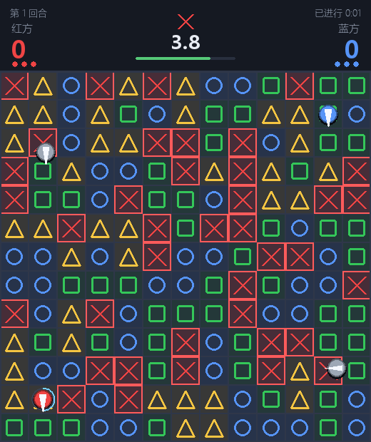
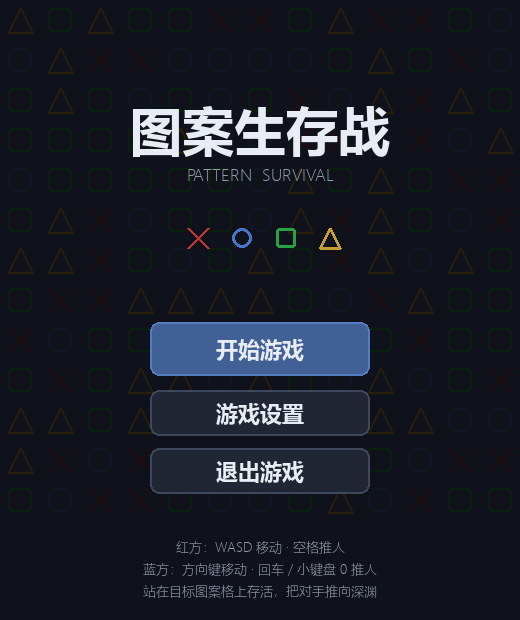
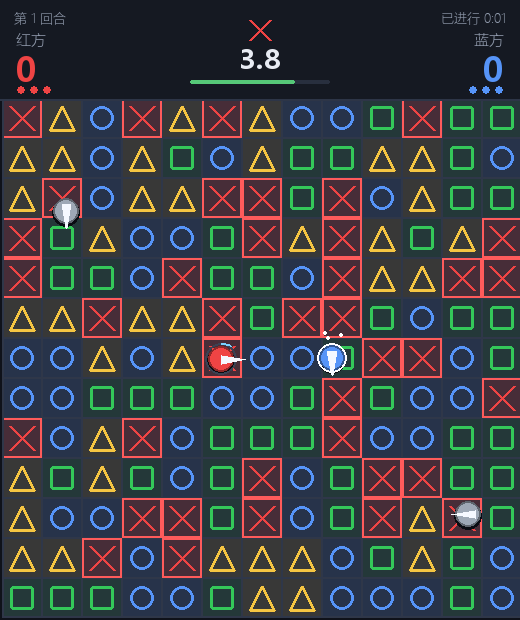
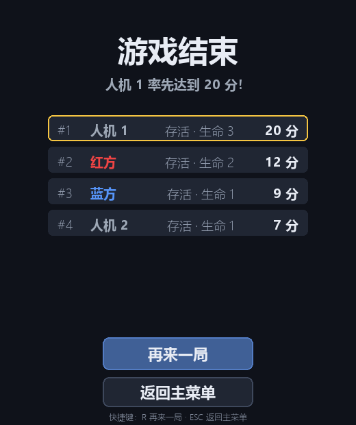

# 图案生存战 Pattern Survival


一款基于 **Python 3 + pygame** 的 2D 实时对抗小游戏。

13×13 的图案棋盘每回合随机重铺 ×、○、□、△ 四种图案，HUD 随机指定一个
目标图案并倒计时——倒计时结束时只有目标图案格保留，其余全部塌陷成虚空，
站在上面的单位会立刻掉下去。红蓝两名玩家同屏对抗，若干中立人机（AI）
抢格、推人、逃生，并参与胜负排名。



## 特性

- **回合制生存玩法**：每回合重新随机铺图，追随目标图案与倒计时抢占安全格
- **推人对抗系统**：把对手推向即将塌陷的格子；支持连锁推、击退眩晕、
  冷却圆环进度条与指针伸出动作
- **同屏双人 + 中立 AI**：红蓝各一套按键；人机具备"找安全格 / 抢格 / 推人 /
  逃生 / 随机扰动"行为状态机，三档难度可调
- **平滑的实时操作**：20 Hz 固定逻辑步进 + 60 FPS 渲染 + 位置插值
- **完整的游戏流程**：主菜单 / 游戏设置 / 对局 / 结算排名，附粒子、震屏、
  格子碎裂等视觉特效
- **多平台适配**：Windows 下自动处理输入法干扰与窗口失焦，其余平台自动跳过
- **可选对局记录**：每局结束自动导出 JSON（回合布局 + 推人 / 死亡 / 重生事件）

## 快速开始

### 环境要求

- Python 3.8 及以上
- pygame 2.x

> **关于依赖包**：官方 `pygame` 尚未提供 Python 3.14 的预编译包；
> 本项目在 Python 3.14 上使用 API 完全兼容的 **pygame-ce**（社区版分支，
> `import pygame` 用法完全相同）。Python 3.8 ~ 3.13 则两者皆可。

### 安装依赖

```bash
pip install -r requirements.txt

# 国内网络可使用镜像加速：
pip install pygame-ce -i https://pypi.tuna.tsinghua.edu.cn/simple
# Python 3.8 ~ 3.13 也可安装官方版 pygame
```

### 运行

```bash
# 在项目根目录（本 README 所在目录）执行：
python main.py
```

Windows 用户还可直接双击 `start.bat`（含错误提示与暂停）。

### 操作按键

| 玩家 | 移动 | 推人 |
| --- | --- | --- |
| 红方（红色单位） | `W` `A` `S` `D` | `空格` |
| 蓝方（蓝色单位） | `方向键` | `回车` 或 `小键盘 0` |

- 移动为实时连续（约 5 格/秒），单位有碰撞体积，不能互相重叠；
- 对局中按 `ESC` 暂停 / 继续，暂停时按 `M` 返回主菜单；
- 结算界面按 `R` 再来一局，按 `ESC` 返回主菜单；
- 窗口失去焦点（切到其他程序 / 最小化）时游戏会自动暂停并提示，
  点击游戏窗口即可继续。

## 玩法规则

### 回合流程

1. 每回合开始重新随机铺满 13×13 四种图案（× 红、○ 蓝、□ 绿、△ 黄）；
2. HUD 随机显示目标图案并倒计时（默认 5 秒，可在设置中修改）；
3. 倒计时结束时只保留目标图案格、其余变虚空：站在消失格上的单位立即
   死亡（掉命，不扣分）；
4. 约 1 秒停顿后进入下一回合，死亡单位在新回合的随机位置重生。

### 推人技能

- 向面朝方向推出 1.5 格内的相邻单位，将其沿该方向击退最多 2 格
  （0.2 秒滑行动画）并眩晕 **0.5 秒**；
- 推人冷却 **1 秒**：冷却期间单位圆形外侧显示**圆环进度条**，1 秒充满
  即表示冷却结束（就绪瞬间满环一闪）；释放技能时，单位朝向的小指针会
  向外伸出，以表现推人动作；
- 若被推单位身后是墙或边界，则推不动——但仍会眩晕；身后有单位时可以
  连锁推（链上每个单位各自最多位移 2 格）；
- 推人本身不造成伤害，但可以把对手推到即将消失的格子上（倒计时结束即死）。

### 死亡与计分

- 计分来源有且只有一种：每回合结算时站在目标图案格上的单位
  **存活 +1 分**；
- 死亡 **不扣分**，只失去一条命，下回合随机地点重生；
- 生命耗尽即为淘汰；**最后留下的单位获胜**；
- 任意单位达到 **20 分** 立即获胜；
- **红蓝双方全部出局（仅剩人机）** 时立即结束并展示分数；
- 对局**没有时间限制**（不设超时；人机同样计入排名）。

### 人机（AI）

- 每个逻辑帧接收观测字典（自身位置 / 眩晕 / 推人冷却、当前目标图案、
  每格图案二维数组、其他单位位置 / 阵营 / 眩晕、倒计时剩余秒数），
  返回 `{"move": (dx, dy), "push": bool}`；
- 行为状态机：找安全格（BFS / A*）→ 抢格 → 推人（已站安全格且旁有单位
  且倒计时 > 1.5 秒）→ 逃生（倒计时 < 1.5 秒且不在安全格）→ 随机扰动；
- 难度从三个方面影响表现：反应速度（决策间隔）、寻路精度（方向抖动与
  选格策略）、推人欲望（执行推人的概率）。

## 游戏截图

| 主菜单 | 推人瞬间 |
| :---: | :---: |
|  |  |
| **结算排名** | **对局掠影** |
|  |  |

## 游戏设置

主菜单 → 游戏设置，可修改以下项目（修改即时生效，返回主菜单后点击
「开始游戏」即按当前配置开新局）：

| 设置项 | 范围 | 默认 |
| --- | --- | --- |
| 人机数量 | 0 ~ 4 | 2 |
| 人机难度 | 简单 / 普通 / 困难 | 普通 |
| 生命数 | 1 ~ 9 | 3 |
| 回合倒计时 | 1.0 ~ 30.0 秒（步进 0.5） | 5.0 秒 |

## 项目结构

```
pattern_survival/
├── main.py               # 入口：App 主循环 + 主菜单/设置/对局/结算四场景
├── config.py             # 全部配置常量与 GameSettings
├── core/                 # 游戏规则
│   ├── grid.py           #   13×13 图案网格（铺图 / 塌陷 / 坐标换算）
│   ├── unit.py           #   单位（移动 / 碰撞 / 眩晕 / 冷却 / 击退）
│   ├── push.py           #   推人结算（命中判定 / 连锁 / 位移）
│   ├── round_manager.py  #   回合状态机（倒计时 / 结算 / 重生 / 停顿）
│   └── score.py          #   计分板与胜负判定
├── ai/                   # 人机
│   ├── base_agent.py     #   代理基类（观测契约 / 反应节流 / 难度参数）
│   ├── pathfind.py       #   BFS 距离场与 A* 最短路
│   └── bot.py            #   行为状态机（找格 / 抢格 / 推人 / 逃生 / 扰动）
├── ui/                   # 界面
│   ├── render.py         #   格子 / 图案 / 单位 / 推人冷却环渲染
│   ├── hud.py            #   比分 / 目标图案闪烁 / 大号倒计时
│   └── effects.py        #   粒子 / 震屏 / 格子碎裂 / 飘字 / 横幅
├── replay/               # 对局记录（可选模块）
│   └── recorder.py       #   记录每回合布局与事件，导出 JSON
├── screenshots/          # 本文档使用的截图
├── requirements.txt
├── start.bat             # Windows 双击启动
└── README.md
```

## 技术实现

- **架构分层**：`core`（纯规则）/ `ai`（决策）/ `ui`（绘制）互不越界——
  AI 只通过观测字典与引擎交互，渲染层不参与规则计算；
- **时间模型**：逻辑固定 **20 Hz**（`TICK_RATE`）步进，渲染 **60 FPS**，
  单位位置在两逻辑帧之间插值，移动平滑；特效以渲染帧更新；
- **窗口尺寸**：**520 × 620** = 13 × 40px 游戏区 + 100px HUD；
- **参数集中**：全部可调参数在 `config.py`（`GRID_SIZE=13`、`CELL_SIZE=40`、
  `ROUND_TIME=5.0`、`WIN_SCORE=20`、`AI_COUNT=2`、`AI_DIFFICULTY="normal"`、
  `PUSH_COOLDOWN=1.0`、`PUSH_STUN=0.5`、`MOVE_SPEED=5.0` 等）；
- **平台适配**：Windows 下自动切断输入法与游戏窗口的关联、监听窗口焦点
  事件（失焦自动暂停）；其余平台自动跳过相关逻辑。

### 对局记录（可选）

每局正常结束时，会自动把"每回合地图布局 + 关键事件（推人 / 死亡 / 重生）"
写入 `replays/replay_时间戳.json`，可用文本编辑器直接查看；
不需要该功能时忽略或删除该目录即可，写入失败不会影响游戏运行。

## 常见问题

- **按键无响应（例如红方 WASD / 空格没反应）**：
  1. 游戏启动时会自动切断中文输入法与游戏窗口的关联（Windows 专属，
     进程退出后自动恢复），正常情况无需手动切换输入法；若仍偶发，
     请按 `Shift` 或 `Ctrl+空格` 把输入法切到英文后再试；
  2. 窗口失去焦点时游戏会自动暂停，画面会明确提示"窗口失去焦点 ·
     已暂停"，点击游戏窗口即可继续；
  3. 若通过 `start.bat` 启动时游戏窗口不在最前，先点击一次游戏窗口
     —— 未激活时画面会提示"点击游戏窗口开始"，游戏会等待激活再开始。
- **中文显示为方块**：系统缺少中文字体，安装微软雅黑 / 黑体 / 宋体 /
  Noto Sans CJK 任意一款即可；
- **`ModuleNotFoundError: No module named 'pygame'`**：按上文安装依赖；
- **窗口偏小或模糊**：程序已启用高 DPI 感知；若仍觉得小，可调低系统
  显示缩放，或修改 `config.py` 中的 `CELL_SIZE`。
